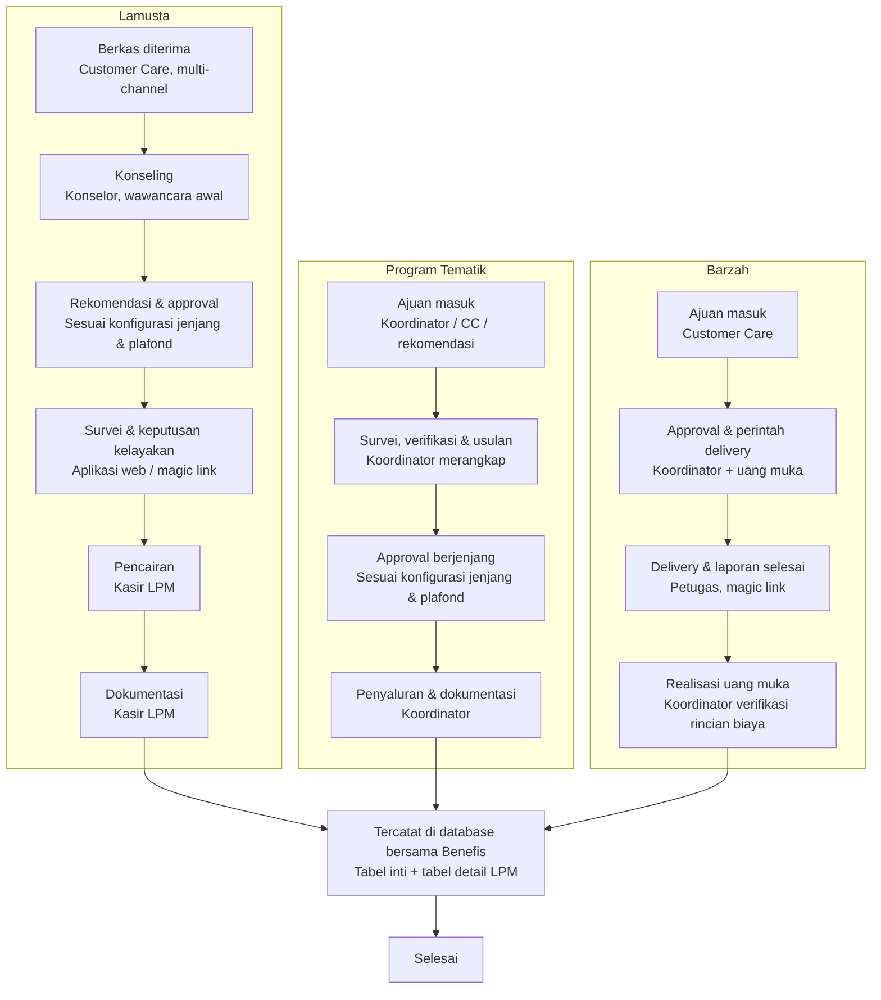
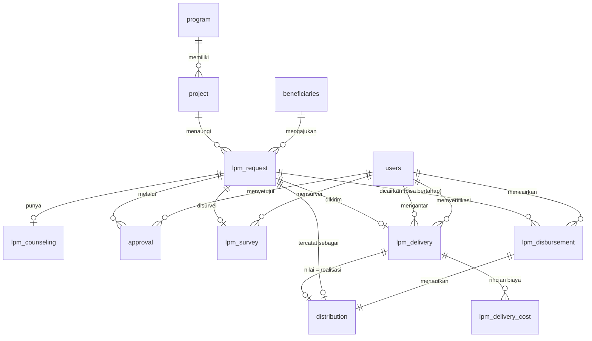

# PRD v2 — Pencatatan & Approval LPM pada Platform Benefis

**Status:** Draft untuk review

**Penulis:** Muhamad Arya Kurniawan (arya@dompetdhuafa.org))
**Melengkapi:** BRD Platform Benefis LPM 2026-2027 v2.0
**Rujukan skema existing:** dataset `benefis-ozip.benefis2_public` (per 26 Agustus 2026)

---

## 1. Latar Belakang

BRD v2.0 mendefinisikan tiga layanan LPM — **Lamusta**, **Program Tematik**, dan **Barzah** — beserta alur proses dan jenjang approval masing-masing. Prinsip arsitektur yang disepakati: **platform LPM tidak membangun database terpisah dan tidak melakukan sinkronisasi ke Benefis**. LPM memakai *database yang sama* dengan Benefis (`benefis2_public`), dan hanya menambahkan **tabel bantu (helper tables)** berprefiks `lpm_` untuk menyimpan detail data yang belum ada di skema inti (`program`, `project`, `beneficiaries`, `distribution`, dst).

Dokumen ini menyatukan alur proses & persetujuan ketiga layanan (Bab 3) dengan kebutuhan skema: kolom apa yang perlu **ditambahkan (ALTER)** ke tabel existing, dan tabel baru apa yang perlu **dibuat**, agar seluruh proses — mulai intake, konseling, approval berjenjang, survei, pencairan, hingga delivery — tercatat penuh di database bersama tanpa duplikasi arti data.

## 2. Prinsip Desain

1. **Satu database, satu sumber kebenaran.** Tidak ada proses sinkronisasi; tabel `lpm_*` merujuk langsung ke `users.uuid`, `beneficiaries.uuid`, `project.uuid`, `distribution.uuid` via foreign key.
2. **`distribution` tetap menjadi tabel transaksi resmi.** Tabel baru `lpm_request` menampung proses *sebelum* transaksi terbentuk (intake → approval → survei); begitu disetujui dan cair, satu baris `distribution` dibuat dan ditautkan balik ke `lpm_request`.
3. **Konsisten dengan konvensi existing:** `uuid` STRING sebagai PK, kolom `*_uuid` sebagai FK, `created_at`/`updated_at`/`deleted_at` TIMESTAMP di setiap tabel transaksional, kolom `datastream_metadata` STRUCT untuk CDC — mengikuti pola tabel `users`, `project`, `distribution` yang sudah ada.
4. **Approval jenjang bersifat generic & terkonfigurasi**, bukan hardcode per layanan — supaya jenjang dan plafond bisa diubah tanpa migrasi skema baru (lihat §6.4 `approval_matrix`). Tabel `approval`, `approval_matrix`, dan `status_log` bersifat **shared** dengan modul Bantuan Hukum (BH) — satu tabel melayani kedua modul via kolom discriminator `module`.

## 3. Alur Proses & Persetujuan

Alur Lamusta, Program Tematik, dan Layanan Barzah — satu database dengan Benefis, dengan tabel bantu tambahan untuk detail data per layanan (arsitektur polymorphic).

**Legenda:** 🟤 Intake/selesai · 🔵 Proses · 🟠 Approval · 🟢 Disetujui/disalurkan · 🟣 Database bersama

### 3.1 Lamusta

1. 🟤 **Berkas diterima** — Customer Care, multi-channel
2. 🔵 **Konseling** — Konselor, wawancara awal
3. 🟠 **Rekomendasi & approval** — sesuai konfigurasi jenjang & plafond (lihat `lpm_approval_matrix`, §6.4)
4. 🔵 **Survei & keputusan kelayakan** — Surveyor, via aplikasi web langsung (dapat pakai magic link)
5. 🟢 **Pencairan** — Kasir LPM, savecash / outstanding
6. 🔵 **Dokumentasi** — Kasir LPM, kuitansi & bukti dibayar

→ lanjut ke **database bersama Benefis**

### 3.2 Program Tematik

*(Yatim, PMTU, Disabilitas Mandiri)*

1. 🟤 **Ajuan masuk** — Koordinator / CC / rekomendasi
2. 🔵 **Survei, verifikasi & usulan** — Koordinator merangkap
3. 🟠 **Approval berjenjang** — sesuai konfigurasi jenjang & plafond (lihat `lpm_approval_matrix`, §6.4)
4. 🟢 **Penyaluran & dokumentasi** — Koordinator

→ lanjut ke **database bersama Benefis**

### 3.3 Barzah

1. 🟤 **Ajuan masuk** — Customer Care
2. 🟠 **Approval & perintah delivery** — Koordinator
3. 🟢 **Delivery & laporan selesai** — Petugas, via magic link
4. 🔵 **Realisasi uang muka** — Koordinator verifikasi rincian biaya terpakai

→ lanjut ke **database bersama Benefis**

> **Uang muka & nilai manfaat (keputusan desain).** Saat perintah delivery terbit, Koordinator menyerahkan **uang muka perjalanan** ke petugas (tunai/transfer) dengan batas laporan. Officer memindahkan isi laporan petugas ke rincian biaya (BBM, tol, ojol, layanan jenazah, adhkarial/PAB, honor). **Nilai yang dicatat sebagai transaksi manfaat di Benefis adalah total realisasi terpakai — bukan nominal uang muka.** Sisa uang muka wajib dikembalikan petugas; realisasi yang melebihi muka memerlukan persetujuan Koordinator sebelum transaksi dibuat.

### 3.4 Titik Temu

🟣 **Tercatat di database bersama Benefis** — tabel inti Penerima Manfaat/Program/Transaksi + tabel detail LPM

↓

🟤 **Selesai**

### 3.5 Diagram Alur (Mermaid)

*Catatan: cabang penolakan/tidak layak (berujung Arsip → Selesai) tidak ditampilkan di sini — fokus diagram adalah jalur disetujui.*

## 4. Pemetaan Alur → Kebutuhan Data

| Layanan         | Tahap                                                         | Entitas Data yang Terlibat                              |
| --------------- | ------------------------------------------------------------- | ------------------------------------------------------- |
| Lamusta         | Berkas diterima                                               | `lpm_request` (baru)                                  |
| Lamusta         | Konseling                                                     | `lpm_counseling` (baru)                               |
| Lamusta         | Rekomendasi & approval (sesuai konfigurasi jenjang & plafond) | `approval` *(shared)*, `approval_matrix` *(shared)* |
| Lamusta         | Survei & keputusan kelayakan (web/magic link)                 | `lpm_survey` (baru)                                   |
| Lamusta         | Pencairan (Kasir LPM)                                         | `lpm_disbursement` (baru), `distribution` (ALTER)   |
| Lamusta         | Dokumentasi (Kasir LPM, bukti bayar)                          | `lpm_disbursement` (baru)                             |
| Program Tematik | Ajuan masuk                                                   | `lpm_request` (baru)                                  |
| Program Tematik | Survei, verifikasi & usulan (Koordinator merangkap)           | `lpm_survey` (baru)                                   |
| Program Tematik | Approval berjenjang (sesuai konfigurasi jenjang & plafond)    | `approval` *(shared)*, `approval_matrix` *(shared)* |
| Program Tematik | Penyaluran & dokumentasi                                      | `lpm_disbursement`, `distribution` (ALTER)          |
| Barzah          | Ajuan masuk                                                   | `lpm_request`                                         |
| Barzah          | Approval & perintah delivery                                  | `approval` *(shared)*                                |
| Barzah          | Delivery & laporan selesai (magic link)                       | `lpm_delivery` (baru)                                 |
| Barzah          | Realisasi uang muka (rekonsiliasi & verifikasi)              | `lpm_delivery` + `lpm_delivery_cost` (baru)         |
| Semua           | Setiap perpindahan status                                     | `status_log` *(shared)*                              |

## 5. Usulan ALTER Tabel Existing

### 5.1 `distribution`

Menautkan transaksi resmi ke proses LPM dan mempercepat pelaporan tanpa join berlapis.

| Kolom Baru              | Tipe Data | Keterangan                                                                                                                                    |
| ----------------------- | --------- | --------------------------------------------------------------------------------------------------------------------------------------------- |
| `request_module` | STRING | `LPM`. Menandai modul asal request. Nullable — diisi untuk transaksi dari modul LPM atau BH. |
| `request_uuid` | STRING | FK generik ke `lpm_request.uuid` atau `bh_request.uuid`. Nullable — diisi bersamaan dengan `request_module`. |
| `service_type` | STRING | `LAMUSTA` \| `PROGRAM_TEMATIK` \| `BARZAH`. Denormalisasi dari `lpm_request` agar laporan bisa filter langsung dari `distribution`. |
| `disbursement_method` | STRING | `SAVECASH` \| `OUTSTANDING` \| `BANK_TRANSFER`. Dipakai untuk pencairan (LPM) atau pembayaran ke mitra (BH). |

### 5.2 `project`

| Kolom Baru           | Tipe Data | Keterangan                                                                             |
| -------------------- | --------- | -------------------------------------------------------------------------------------- |
| `lpm_service_type` | STRING    | Nullable. Menandai proyek yang dikelola sebagai payung Lamusta/Program Tematik/Barzah. |

> **Alternatif tanpa alter:** manfaatkan `project_category` yang sudah ada — buat 3 baris kategori dengan `pilar = 'LPM'` dan `name` = `Lamusta` / `Program Tematik` / `Barzah`, lalu filter lewat `project.category_uuid`. Ini menghindari alter, tapi query pelaporan jadi selalu perlu join ke `project_category`. **Rekomendasi:** pakai `project_category` dulu (tanpa alter) kecuali kebutuhan reporting menuntut kolom langsung di `project`.

### 5.3 `roles`

| Kolom Baru         | Tipe Data | Keterangan                                                                                                                                                                    |
| ------------------ | --------- | ----------------------------------------------------------------------------------------------------------------------------------------------------------------------------- |
| `approval_level` | INT64     | Nullable. Urutan jenjang approval generic:`1=Koordinator, 2=Kabag, 3=Manajer, 4=GM, 5=Direktur`. Dipakai mesin approval untuk auto-routing tanpa hardcode role per layanan. |

### 5.4 `beneficiaries` *(opsional)*

| Kolom Baru               | Tipe Data | Keterangan                                                                                                                                            |
| ------------------------ | --------- | ----------------------------------------------------------------------------------------------------------------------------------------------------- |
| `registration_channel` | STRING    | Nullable. Mencatat channel pendaftaran awal (WA/Telepon/Datang langsung/Email) bila ingin direkam di level penerima manfaat, bukan hanya per-request. |

## 6. Usulan Tabel Tambahan (`lpm_*`)

### 6.1 `lpm_request`

Tabel inti — merepresentasikan satu pengajuan bantuan sejak masuk hingga selesai, untuk ketiga layanan.

| Kolom                                            | Tipe Data | Keterangan                                                                                                                                        |
| ------------------------------------------------ | --------- | ------------------------------------------------------------------------------------------------------------------------------------------------- |
| `uuid`                                         | STRING    | Primary Key.                                                                                                                                      |
| `request_hid`                                  | STRING    | ID mudah dibaca, mis.`LMS-2026-000123`.                                                                                                         |
| `service_type`                                 | STRING    | `LAMUSTA` \| `PROGRAM_TEMATIK` \| `BARZAH`.                                                                                                 |
| `project_uuid`                                 | STRING    | FK`project.uuid`. Proyek/payung program terkait.                                                                                                |
| `beneficiary_uuid`                             | STRING    | FK`beneficiaries.uuid`.                                                                                                                         |
| `channel`                                      | STRING    | Channel masuk (WA, Telepon, Datang langsung, Email, Rekomendasi Amil).                                                                            |
| `status`                                       | STRING    | `DRAFT`, `MENUNGGU_KONSELING`, `MENUNGGU_APPROVAL`, `MENUNGGU_SURVEI`, `DISETUJUI`, `DITOLAK`, `PENCAIRAN`, `SELESAI`, `ARSIP`. |
| `requested_amount`                             | NUMERIC   | Nominal yang diajukan.                                                                                                                            |
| `approved_amount`                              | NUMERIC   | Nominal hasil approval (bisa berbeda dari pengajuan).                                                                                             |
| `rejection_reason`                             | STRING    | Alasan penolakan (jika`DITOLAK`).                                                                                                               |
| `konselor_user_uuid`                           | STRING    | FK`users.uuid`. Khusus Lamusta.                                                                                                                 |
| `surveyor_user_uuid`                           | STRING    | FK`users.uuid`.                                                                                                                                 |
| `kasir_user_uuid`                              | STRING    | FK`users.uuid`.                                                                                                                                 |
| `petugas_delivery_user_uuid`                   | STRING    | FK`users.uuid`. Khusus Barzah.                                                                                                                  |
| `magic_link_token`                             | STRING    | Token akses untuk survei/delivery via magic link.                                                                                                 |
| `magic_link_expired_at`                        | TIMESTAMP | Kedaluwarsa token.                                                                                                                                |
| `created_by_user_uuid`                         | STRING    | FK`users.uuid`. Petugas yang menginput ajuan (CC/Koordinator).                                                                                  |
| `created_at` / `updated_at` / `deleted_at` | TIMESTAMP | Standar.                                                                                                                                          |
| `datastream_metadata`                          | STRUCT    | Metadata sinkronisasi CDC.                                                                                                                        |

### 6.2 `lpm_counseling` *(khusus Lamusta)*

| Kolom                                            | Tipe Data | Keterangan                                            |
| ------------------------------------------------ | --------- | ----------------------------------------------------- |
| `uuid`                                         | STRING    | Primary Key.                                          |
| `request_uuid`                                 | STRING    | FK`lpm_request.uuid`.                               |
| `konselor_user_uuid`                           | STRING    | FK`users.uuid`.                                     |
| `session_notes`                                | STRING    | Catatan hasil wawancara.                              |
| `recommendation`                               | STRING    | `DIBANTU` \| `TIDAK_DIBANTU` \| `PERLU_SURVEI`. |
| `session_date`                                 | TIMESTAMP | Waktu sesi konseling.                                 |
| `created_at` / `updated_at` / `deleted_at` | TIMESTAMP | Standar.                                              |
| `datastream_metadata`                          | STRUCT    | Metadata CDC.                                         |

### 6.3 `approval` *(shared — BH & LPM)*

Tabel approval generik yang dipakai bersama oleh modul LPM dan Bantuan Hukum. Satu baris per jenjang persetujuan yang dilalui satu request. Kolom `module` membedakan asal data. Definisi lengkap lihat §6.11 di dokumen PRD Bantuan Hukum.

| Kolom                           | Tipe Data | Keterangan                                                             |
| ------------------------------- | --------- | ---------------------------------------------------------------------- |
| `uuid`                        | STRING    | Primary Key.                                                           |
| `module`                      | STRING    | `BH` \| `LPM`. Penanda modul asal request.                           |
| `request_uuid`                | STRING    | FK ke `lpm_request.uuid` (jika `module=LPM`) atau `bh_request.uuid` (jika `module=BH`). |
| `level`                       | STRING    | `KOORDINATOR` \| `KABAG` \| `MANAJER` \| `GM` \| `DIREKTUR`. |
| `sequence_order`              | INT64     | Urutan jenjang untuk request ini (1, 2, 3, ...).                       |
| `approver_user_uuid`          | STRING    | FK`users.uuid`.                                                      |
| `status`                      | STRING    | `PENDING` \| `APPROVED` \| `REJECTED`.                           |
| `notes`                       | STRING    | Catatan approver.                                                      |
| `decided_at`                  | TIMESTAMP | Waktu keputusan.                                                       |
| `created_at` / `updated_at` | TIMESTAMP | Standar.                                                               |
| `datastream_metadata`         | STRUCT    | Metadata CDC.                                                          |

### 6.4 `approval_matrix` *(shared — BH & LPM)*

Tabel referensi/konfigurasi yang dipakai bersama — menentukan jenjang mana saja yang wajib dilalui, berdasarkan modul, layanan, dan plafond nominal. Menghindari hardcode logika approval di kode aplikasi. Definisi lengkap lihat §6.11 di dokumen PRD Bantuan Hukum.

| Kolom                           | Tipe Data | Keterangan                                                                                                                                                                                  |
| ------------------------------- | --------- | ------------------------------------------------------------------------------------------------------------------------------------------------------------------------------------------- |
| `uuid`                        | STRING    | Primary Key.                                                                                                                                                                                |
| `module`                      | STRING    | `BH` \| `LPM`. Penanda modul.                                                                                                                                                             |
| `service_type`                | STRING    | `BANTUAN_HUKUM` \| `LAMUSTA` \| `PROGRAM_TEMATIK` \| `BARZAH`.                                                                                                                           |
| `min_amount`                  | NUMERIC   | Batas bawah plafond (inklusif).                                                                                                                                                             |
| `max_amount`                  | NUMERIC   | Batas atas plafond (NULL = tidak terbatas).                                                                                                                                                 |
| `required_levels`             | JSON      | Array jenjang yang wajib menyetujui untuk rentang ini — bisa satu level saja (mis.`["GM"]`) atau berantai (mis. `["MANAJER","GM","DIREKTUR"]`), sepenuhnya sesuai konfigurasi. |
| `is_active`                   | BOOL      | Status aktif baris konfigurasi.                                                                                                                                                             |
| `created_at` / `updated_at` | TIMESTAMP | Standar.                                                                                                                                                                                    |

**Konfigurasi hasil forum 26 Agustus 2026 bersama LPM:**

Setiap layanan diberi ambang plafond sendiri, dan setiap rentang plafond memerlukan **satu** approver sesuai tingkatnya — bukan rantai wajib melalui semua level di bawahnya, kecuali dinyatakan lain. Seluruhnya dikelola lewat data di `lpm_approval_matrix`, tanpa ubah kode maupun skema.

| service_type    | min_amount | max_amount | required_levels                 |
| --------------- | ---------- | ---------- | ------------------------------- |
| LAMUSTA         | 0          | 750.000    | `["KOORDINATOR"]`             |
| LAMUSTA         | 750.001    | 1.500.000  | `["KABAG"]`                   |
| LAMUSTA         | 1.500.001  | 4.999.999  | `["MANAJER"]`                 |
| LAMUSTA         | 5.000.000  | 49.999.999 | `["GM"]`                      |
| LAMUSTA         | 50.000.000 | *(null)* | `["DIREKTUR"]`                |
| PROGRAM_TEMATIK | 0          | 5.000.000  | `["MANAJER"]`                 |
| PROGRAM_TEMATIK | 5.000.001  | *(null)* | `["MANAJER","GM","DIREKTUR"]` |
| BARZAH          | 0          | *(null)* | `["KOORDINATOR"]`             |

Barzah cukup satu jenjang (Koordinator) tanpa memandang nominal, karena sifatnya perintah delivery, bukan pencairan dana.

### 6.5 `lpm_survey`

| Kolom                                            | Tipe Data | Keterangan                                                  |
| ------------------------------------------------ | --------- | ----------------------------------------------------------- |
| `uuid`                                         | STRING    | Primary Key.                                                |
| `request_uuid`                                 | STRING    | FK`lpm_request.uuid`.                                     |
| `surveyor_user_uuid`                           | STRING    | FK`users.uuid`.                                           |
| `method`                                       | STRING    | `APLIKASI_WEB` \| `MAGIC_LINK`.                         |
| `magic_link_token`                             | STRING    | Diisi bila`method = MAGIC_LINK`.                          |
| `result`                                       | STRING    | `LAYAK` \| `TIDAK_LAYAK` \| `PERLU_PERHATIAN_KHUSUS`. |
| `notes`                                        | STRING    | Catatan hasil survei.                                       |
| `latitude` / `longitude`                     | NUMERIC   | Titik lokasi survei.                                        |
| `photo_urls`                                   | JSON      | Array URL foto/dokumentasi survei.                          |
| `surveyed_at`                                  | TIMESTAMP | Waktu survei dilakukan.                                     |
| `created_at` / `updated_at` / `deleted_at` | TIMESTAMP | Standar.                                                    |
| `datastream_metadata`                          | STRUCT    | Metadata CDC.                                               |

### 6.6 `lpm_disbursement` *(Kasir LPM — Lamusta & Program Tematik)*

Mendukung pencairan bertahap (parsial): satu `lpm_request` dapat memiliki lebih dari satu baris `lpm_disbursement`, masing-masing mewakili satu tahap pembayaran dan satu transaksi `distribution`.

| Kolom                                            | Tipe Data | Keterangan                                                                                                                                                                |
| ------------------------------------------------ | --------- | ------------------------------------------------------------------------------------------------------------------------------------------------------------------------- |
| `uuid`                                         | STRING    | Primary Key.                                                                                                                                                              |
| `request_uuid`                                 | STRING    | FK`lpm_request.uuid`.                                                                                                                                                   |
| `distribution_uuid`                            | STRING    | FK`distribution.uuid`. Diisi setelah transaksi resmi tahap ini dibuat.                                                                                                  |
| `kasir_user_uuid`                              | STRING    | FK`users.uuid`.                                                                                                                                                         |
| `installment_sequence`                         | INT64     | Urutan tahap pencairan (1, 2, 3, ...). Bernilai 1 jika pencairan penuh/sekali bayar.                                                                                      |
| `amount`                                       | NUMERIC   | Nominal pencairan tahap ini. Total seluruh tahap untuk satu`request_uuid` tidak boleh melebihi `lpm_request.approved_amount` (aturan bisnis, divalidasi di aplikasi). |
| `method`                                       | STRING    | `SAVECASH` \| `OUTSTANDING`.                                                                                                                                          |
| `receipt_file_url`                             | STRING    | URL kuitansi/bukti bayar tahap ini.                                                                                                                                       |
| `receipt_uploaded_at`                          | TIMESTAMP | Waktu bukti diunggah.                                                                                                                                                     |
| `paid_at`                                      | TIMESTAMP | Waktu pencairan tahap ini.                                                                                                                                                |
| `status`                                       | STRING    | `BELUM_DIBAYAR` \| `DIBAYAR` \| `DIBATALKAN`.                                                                                                                       |
| `created_at` / `updated_at` / `deleted_at` | TIMESTAMP | Standar.                                                                                                                                                                  |
| `datastream_metadata`                          | STRUCT    | Metadata CDC.                                                                                                                                                             |

### 6.7 `lpm_delivery` *(khusus Barzah)*

| Kolom                                            | Tipe Data | Keterangan                                                  |
| ------------------------------------------------ | --------- | ----------------------------------------------------------- |
| `uuid`                                         | STRING    | Primary Key.                                                |
| `request_uuid`                                 | STRING    | FK`lpm_request.uuid`.                                     |
| `petugas_user_uuid`                            | STRING    | FK`users.uuid`.                                           |
| `magic_link_token`                             | STRING    | Token akses form laporan delivery.                          |
| `magic_link_expired_at`                        | TIMESTAMP | Kedaluwarsa token.                                          |
| `delivery_status`                              | STRING    | `BELUM_BERANGKAT` \| `DALAM_PERJALANAN` \| `SELESAI`. |
| `delivery_report`                              | STRING    | Catatan laporan petugas.                                    |
| `delivery_photo_urls`                          | JSON      | Array URL dokumentasi delivery.                             |
| `completed_at`                                 | TIMESTAMP | Waktu laporan selesai dikirim.                              |
| `advance_amount`                               | NUMERIC   | Nominal uang muka perjalanan yang diserahkan ke petugas. **Bukan nilai manfaat.** |
| `advance_method`                               | STRING    | `TUNAI` \| `TRANSFER`.                                      |
| `advance_paid_at`                              | TIMESTAMP | Waktu uang muka diserahkan ke petugas.                     |
| `advance_report_due_at`                        | TIMESTAMP | Batas petugas melaporkan realisasi.                         |
| `realization_status`                           | STRING    | `BELUM_LAPOR` \| `DILAPORKAN` \| `TERVERIFIKASI` \| `SELISIH_LEBIH`. |
| `realization_amount`                           | NUMERIC   | Total biaya terpakai (jumlah baris `lpm_delivery_cost`). **Nilai ini yang menjadi `distribution.amount`.** |
| `returned_amount`                              | NUMERIC   | Sisa uang muka yang dikembalikan petugas (`advance_amount` − `realization_amount` bila positif). |
| `returned_at`                                  | TIMESTAMP | Waktu sisa uang muka diterima Koordinator.                 |
| `distribution_uuid`                            | STRING    | FK`distribution.uuid`. Diisi saat verifikasi — hasil pencatatan transaksi manfaat. |
| `verified_by_user_uuid`                        | STRING    | FK`users.uuid`. Koordinator yang memverifikasi realisasi.    |
| `verified_at`                                  | TIMESTAMP | Waktu verifikasi realisasi.                                |
| `created_at` / `updated_at` / `deleted_at` | TIMESTAMP | Standar.                                                    |
| `datastream_metadata`                          | STRUCT    | Metadata CDC.                                               |

### 6.7b `lpm_delivery_cost` *(khusus Barzah — rincian biaya terpakai)*

Satu request Barzah bisa punya banyak baris biaya. Jumlah `amount` seluruh baris = `lpm_delivery.realization_amount`.

| Kolom              | Tipe Data | Keterangan                                                                                     |
| ------------------ | --------- | ---------------------------------------------------------------------------------------------- |
| `uuid`             | STRING    | Primary Key.                                                                                   |
| `delivery_uuid`    | STRING    | FK `lpm_delivery.uuid`.                                                                        |
| `cost_category`    | STRING    | `BBM_TRANSPORTASI` \| `TOL_PARKIR` \| `OJOL_ANGKUT` \| `LAYANAN_JENAZAH` \| `ADHKARIAL_PAB` \| `HONOR_PETUGAS` \| `LAIN_LAIN`. |
| `amount`           | NUMERIC   | Nominal biaya pada baris ini.                                                                 |
| `description`      | STRING    | Keterangan bebas (mis. "2x refill Pertalite").                                                  |
| `receipt_url`      | STRING    | URL nota/kuitansi pendukung.                                                                    |
| `created_by_user_uuid` | STRING | FK `users.uuid`. Koordinator yang memindahkan isi laporan petugas.                            |
| `created_at` / `updated_at` / `deleted_at` | TIMESTAMP | Standar.                                                  |
| `datastream_metadata` | STRUCT | Metadata CDC.                                                                                  |

### 6.8 `status_log` *(shared — BH & LPM)*

Audit trail lintas seluruh entitas di modul LPM dan BH — memenuhi ketentuan "setiap perpindahan status wajib mencatat 1 baris log". Definisi lengkap lihat §6.11 di dokumen PRD Bantuan Hukum.

| Kolom                    | Tipe Data | Keterangan                                                                                         |
| ------------------------ | --------- | -------------------------------------------------------------------------------------------------- |
| `uuid`                 | STRING    | Primary Key.                                                                                       |
| `module`               | STRING    | `BH` \| `LPM`. Penanda modul asal log.                                                           |
| `entity_type`          | STRING    | `BH_REQUEST` \| `BH_APPROVAL` \| `BH_PARTNER_ASSIGNMENT` \| `BH_CASE_STATUS` \| `BH_PARTNER_REPORT` \| `BH_PAYMENT` \| `LPM_REQUEST` \| `LPM_APPROVAL` \| `LPM_SURVEY` \| `LPM_DISBURSEMENT` \| `LPM_DELIVERY`. |
| `entity_uuid`          | STRING    | UUID baris terkait di tabel entity_type tersebut.                                                  |
| `from_status`          | STRING    | Status sebelumnya.                                                                                 |
| `to_status`            | STRING    | Status baru.                                                                                       |
| `changed_by_user_uuid` | STRING    | FK`users.uuid`.                                                                                  |
| `notes`                | STRING    | Catatan perubahan.                                                                                 |
| `changed_at`           | TIMESTAMP | Waktu perubahan.                                                                                   |

## 6.9 Catatan Tabel Shared

Tabel `approval`, `approval_matrix`, dan `status_log` bersifat **shared** — dipakai bersama oleh modul LPM dan Bantuan Hukum (BH). Kolom `module` pada ketiga tabel berfungsi sebagai discriminator untuk membedakan asal data. Pendekatan ini menghindari duplikasi tabel dengan struktur identik dan memudahkan query pelaporan lintas modul.

Pemodelan relasi untuk tabel shared:
- `approval.request_uuid`指向 ke `lpm_request.uuid` jika `module='LPM'`, atau ke `bh_request.uuid` jika `module='BH'`. FK constraint dikelola di level aplikasi (polymorphic), bukan database constraint langsung.
- `status_log.entity_type` mencakup entitas dari kedua modul.

Definisi lengkap kolom dan contoh data `approval_matrix` lihat §6.4–§6.5 di dokumen ini, serta §6.4–§6.5 di dokumen PRD Bantuan Hukum.

## 7. Relasi Antar Tabel (ERD Logic)

| Tabel Sumber         | Kolom                    | Tabel Tujuan                             | Tipe Relasi                                             |
| -------------------- | ------------------------ | ---------------------------------------- | ------------------------------------------------------- |
| `lpm_request`      | `project_uuid`         | `project`                              | M:1                                                     |
| `lpm_request`      | `beneficiary_uuid`     | `beneficiaries`                        | M:1                                                     |
| `lpm_request`      | `created_by_user_uuid` | `users`                                | M:1                                                     |
| `lpm_counseling`   | `request_uuid`         | `lpm_request`                          | M:1                                                     |
| `lpm_counseling`   | `konselor_user_uuid`   | `users`                                | M:1                                                     |
| `approval`         | `request_uuid`         | `lpm_request`                          | M:1 *(shared — modul LPM)*                             |
| `approval`         | `approver_user_uuid`   | `users`                                | M:1                                                     |
| `lpm_survey`       | `request_uuid`         | `lpm_request`                          | M:1                                                     |
| `lpm_survey`       | `surveyor_user_uuid`   | `users`                                | M:1                                                     |
| `lpm_disbursement` | `request_uuid`         | `lpm_request`                          | M:1*(satu request bisa punya banyak tahap pencairan)* |
| `lpm_disbursement` | `distribution_uuid`    | `distribution`                         | 1:1                                                     |
| `lpm_disbursement` | `kasir_user_uuid`      | `users`                                | M:1                                                     |
| `lpm_delivery`     | `request_uuid`         | `lpm_request`                          | M:1                                                     |
| `lpm_delivery`     | `petugas_user_uuid`    | `users`                                | M:1                                                     |
| `lpm_delivery`     | `verified_by_user_uuid`| `users`                                | M:1                                                     |
| `lpm_delivery`     | `distribution_uuid`    | `distribution`                         | 1:1 *(terisi saat verifikasi realisasi)*                |
| `lpm_delivery_cost`| `delivery_uuid`        | `lpm_delivery`                         | M:1 *(satu delivery punya banyak baris biaya)*          |
| `distribution`     | `request_module` + `request_uuid` | `lpm_request` *(polymorphic)* | M:1                                                     |
| `distribution`     | `project_uuid`         | `project`                              | M:1                                                     |
| `distribution`     | `beneficiary_uuid`     | `beneficiaries`                        | M:1                                                     |
| `status_log`       | `entity_uuid`          | *(polymorphic sesuai `entity_type`)* | M:1 *(shared — modul LPM)*                             |

### Diagram (Mermaid ERD)

## 8. Pertimbangan Non-Fungsional

- **Soft delete konsisten:** semua tabel baru memakai `deleted_at`, mengikuti pola `users`/`project`/`distribution`.
- **CDC/`datastream_metadata`:** disertakan di semua tabel baru agar pipeline sinkronisasi data existing (jika ada, mis. ke BigQuery reporting) tetap kompatibel tanpa penanganan khusus.
- **Idempotensi magic link:** `magic_link_token` di `lpm_request`, `lpm_survey`, dan `lpm_delivery` sebaiknya di-generate ulang per sesi dan diberi masa berlaku (`*_expired_at`) untuk mencegah akses form setelah proses selesai.
- **Konsistensi status:** nilai `status` sebaiknya didefinisikan sebagai enum terpusat (bukan free text) agar `status_log` dan filter pelaporan tetap rapi.
- **Tabel shared (`approval`, `approval_matrix`, `status_log`):** ketiga tabel ini dipakai bersama oleh modul LPM dan BH. Kolom `module` berfungsi sebagai discriminator. FK `approval.request_uuid` bersifat polymorphic —指向 ke `lpm_request.uuid` atau `bh_request.uuid` tergantung nilai `module`. Validasi referential integrity dikelola di level aplikasi, bukan database constraint.

## 9. Keputusan Hasil Konfirmasi

Poin-poin berikut sudah dikonfirmasi dalam forum 26 Agustus 2026 bersama LPM.

**9.1 Approval berjenjang Lamusta** — dikonfirmasi memakai plafond bertingkat, satu approver per rentang (bukan rantai wajib semua level): Koordinator (≤ Rp750.000) → Kabag (≤ Rp1.500.000) → Manajer (< Rp5.000.000) → GM (Rp5.000.000 – < Rp50.000.000) → Direktur (> Rp50.000.000). Konfigurasi ini sudah dituangkan ke contoh isi `approval_matrix` (shared) di §6.4.

**9.2 Approval Barzah** — dikonfirmasi cukup satu jenjang, yaitu Koordinator, tanpa memandang nominal. Tidak perlu eskalasi ke Kabag/Manajer/GM/Direktur.

**9.3 Uang muka & nilai transaksi Barzah** — Perintah delivery memuat nominal uang muka perjalanan (tunai/transfer) yang diserahkan ke petugas sebelum keberangkatan, beserta batas laporan. Laporan lewat magic link memuat rincian biaya terpakai; Koordinator memverifikasinya. **Nilai transaksi manfaat di Benefis = total realisasi terpakai, bukan nominal uang muka.** Sisa uang muka dikembalikan petugas (`returned_amount`); selisih lebih memerlukan persetujuan Koordinator dan tidak boleh creating `distribution` sebelum disetujui. Kolom bertanda **"Bukan nilai manfaat"** pada `lpm_delivery` sengaja ada supaya tidak salah dipakai saat pelaporan.

**9.3 Pencairan parsial** — dikonfirmasi didukung. `lpm_disbursement` diubah menjadi relasi satu-ke-banyak terhadap `lpm_request` (§6.6), dengan kolom `installment_sequence` dan `amount` per tahap, sehingga satu request bisa dicairkan lebih dari satu kali.

**9.4 Struktur storage foto/dokumen** — dikonfirmasi mengikuti best practice yang sudah ada di skema existing, yaitu memakai pola URL/bucket yang sama dengan `project.file_url` dan `beneficiaries.profile_picture_url`, tanpa bucket khusus LPM.
