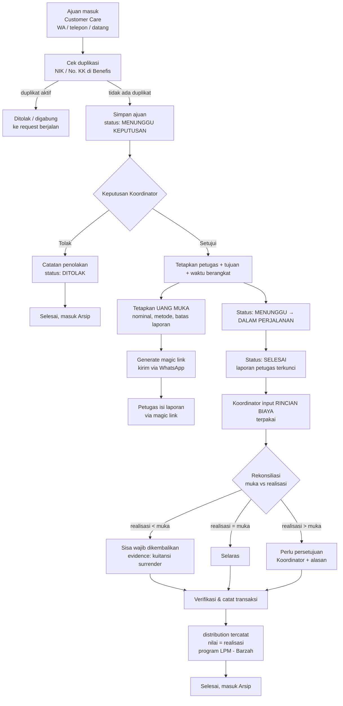

# SOP Alur Kerja Ajuan Barzah (Layanan Mobil Jenazah)

**Dokumen** : SOP Operasional Barzah
**Versi** : 1.0
**Tanggal** : 26 Agustus 2026
** Berlaku untuk** : LPM Dompet Dhuafa — seluruh cabang
**Halaman sistem** : `lpm2/lpm-barzah.html`, `lpm2/lpm-intake-barzah.html`, `lpm2/lpm-delivery-barzah.html`, `lpm2/lpm-pencairan-barzah.html`, `lpm2/lpm-realisasi-barzah.html`

---

## 1. Ringkasan

Barzah adalah layanan mobil jenazah untuk membantu keluarga dhuafa. Alurnya paling sederhana di antara tiga layanan LPM: Alurnya paling sederhana di antara tiga layanan LPM: **tidak ada survei, tidak ada skoring, tidak ada pencairan bertahap**. Satu keputusan (Koordinator) dan satu laporan (Petugas) sudah menutup proses.

```
Ajuan masuk → Keputusan Koordinator + Uang Muka → Delivery → Laporan Petugas
→ Realisasi Uang Muka → Transaksi Manfaat di Benefis
```

**Prinsip utama:**

| Nilai uang | Sifat | Dicatat di |
| --- | --- | --- |
| Uang muka perjalanan | Alat pencairan, diberikan ke petugas | `lpm_delivery.advance_amount` |
| Realisasi biaya terpakai | **Nilai manfaat** | `lpm_delivery.realization_amount` → `distribution.amount` |

Nilai manfaat di Benefis = **total realisasi**, bukan nominal uang muka. Aturan ini berlaku di seluruh dokumen, form, dan laporan.

---

## 2. Peran dan Kewenangan

| Peran | Sistem login | Kewenangan dalam alur Barzah |
| --- | --- | --- |
| **Customer Care** | Login | Input ajuan, menerima permintaan telepon/WA/datang, Unduh laporan |
| **Koordinator** | Login | Setuju/tolak ajuan, tetapkan petugas, tetapkan uang muka, ubah status delivery, verifikasi realisasi, kembalikan/minta sisa uang muka |
| **Petugas Delivery** | Magic link (tanpa login) | Isi laporan delivery + rincian penggunaan uang muka |
| **Admin / staf LPM** | Login | Export laporan, konfigurasi tarif |

> Approval Barzah hanya **satu jenjang: Koordinator**, tanpa memandang nominal (PRD §9.2). Tidak ada eskalasi ke Kabag/Manajer/GM/Direktur. Pengecualian satu-satunya: **selisih realisasi lebih dari uang muka**, yang wajib persetujuan Koordinator sebelum transaksi dibuat.

---

## 3. Alur Detail



---

## 4. Langkah 1 — Intake Ajuan (`lpm-intake-barzah.html`)

**PIC:** Customer Care · **SLA:** segera setelah permintaan diterima

### Field wajib

| Field | Keterangan |
| --- | --- |
| Nama Almarhum / Almarhumah | Nama lengkap sesuai KTP |
| Nama Keluarga / Pelapor | Yang mengonnetif ajuan |
| No. HP Pelapor | Nomor WhatsApp utama |
| Alamat Pelapor | Alamat lengkap + RT/RW |
| Lokasi Jenazah / Saat Ini | Titik jemput |
| Lokasi Tujuan | Tujuan akhir (RS, muskula, ruang jenazah) |

### Field opsional

| Field | Keterangan |
| --- | --- |
| Jenis Kelamin | L / P |
| Usia | Tahun |
| Penyebab Kematian | Sakit / kecelakaan / lanjut usia / lainnya |
| Hubungan dengan Jenazah | Istri / Anak / Suami / Orang Tua |
| Waktu Dibutuhkan | Kapan jenazah harus sampai |
| Catatan Khusus | Kondisi jenazah, akses jalan sempit, permintaan khusus |
| Lampiran | Foto jenazah, surat keterangan, dll (maks 10 MB) |

### Aturan

1. **Cek duplikasi wajib** sebelum simpan: NIK jenazah / No. KK pelapor dicek ke `beneficiaries` di Benefis. Jika masih punya bantuan aktif (Lamusta, Yatim, PMTU, Disabilitas Mandiri, atau Barzah), ajuan digabung ke request berjalan, tidak dibuat baru.
2. Nomor ajuan auto dengan format `LMS-2026-XXXXXX`.
3. Status awal: **Menunggu Keputusan**.
4. Semua perubahan status wajib menulis 1 baris `status_log`.

---

## 5. Langkah 2 — Keputusan Koordinator & Uang Muka (`lpm-delivery-barzah.html`)

**PIC:** Koordinator · **SLA:** sebelum waktu dibutuhkan pelapor

### 2.1 Review ajuan

Panel kanan menampilkan: No. Ajuan, status, tanggal ajuan, data jenazah, data pelapor, lokasi jemput, tujuan, riwayat status.

### 2.2 Keputusan

| Tombol | Efek |
| --- | --- |
| **Setujui** | Buka form Delivery + form Uang Muka |
| **Tolak** | Wajib isi Alasan Penolakan (data tidak lengkap / dokumen tidak valid / melewati batas waktu / lainnya) + catatan tambahan |

### 2.3 Form Delivery (wajib)

| Field | Keterangan |
| --- | --- |
| Petugas Delivery | Pilihan dari master petugas |
| Tanggal & Waktu Berangkat | Wajib |
| Estimasi Tiba | Opsional |
| Catatan untuk Petugas | Instruksi khusus |

### 2.4 Form Uang Muka Perjalanan (wajib)

| Field | Keterangan |
| --- | --- |
| Nominal Uang Muka (Rp) | Angka, auto-format ribuan. Ini **bukan** nilai manfaat |
| Metode Serah Terima | Tunai / Transfer |
| Waktu Uang Muka Diberikan | Wajib |
| Batas Laporan Realisasi | Batas akhir petugas lapor |
| Wajibkan lapor realisasi | Checkbox, default aktif |

**Syarat lolos validasi sebelum "Kirim Perintah Delivery":**
- petugas terisi
- waktu berangkat terisi
- nominal uang muka `> 0`
- metode + waktu uang muka terisi
- magic link sudah di-generate

### 2.5 Generate & kirim magic link

Tombol **Generate Link** membuat token unik 8 karakter. Tersedia tombol **Copy Link** dan **WhatsApp**. Pesan WhatsApp otomatis berisi: nama petugas, nomor ajuan, link, nominal uang muka, dan batas pelaporan.

```
Assalamu'alaikum {nama petugas},

Berikut perintah delivery untuk Ajuan LMS-2026-000023:

{link}

Silakan buka link untuk detail dan pengisian laporan.

Uang muka perjalanan: Rp 1.500.000 - wajib lapor realisasi paling lambat 2026-08-29.

Terima kasih.
```

---

## 6. Langkah 3 — Delivery & Laporan Petugas

### 6.1 Status Delivery

| Status | Arti | Siapa ubah |
| --- | --- | --- |
| Menunggu | Perintah sudah dikirim, petugas belum berangkat | Koordinator |
| Dalam Perjalanan | Petugas dalam perjalanan | Koordinator |
| Selesai | Mobil tiba di tujuan | Koordinator |

Saat status **Selesai**, sistem otomatis membuka bagian **Laporan Petugas** (read-only) berisi: waktu berangkat, waktu tiba, kendala, bukti serah terima. Form terkunci setelah disubmit.

### 6.2 Isi laporan oleh petugas (magic link, tanpa login)

| Field | Keterangan |
| --- | --- |
| Waktu Berangkat | Wajib |
| Waktu Tiba | Wajib |
| Kendala | Opsional |
| Bukti Serah Terima | Foto/scan, wajib |

Magic link bersifat **sekali pakai** dengan masa berlaku (`magic_link_expired_at`).

---

## 7. Langkah 4 — Realisasi Uang Muka (`lpm-realisasi-barzah.html`)

**PIC:** Koordinator · **SLA:** maksimal H+1 setelah delivery selesai, atau sesuai batas laporan

Sekali status Selesai, section **Realisasi Uang Muka** terbuka di halaman Perintah Delivery dengan tombol **Input Realisasi**.

### 7.1 Rincian biaya terpakai

Koordinator memindahkan isi laporan petugas ke tabel rincian. Setiap baris:

| Kolom | Isi |
| --- | --- |
| Kategori Biaya | BBM/Transportasi Mobil · Tol & Parkir · Ojol/Angkut Jenazah · Layanan Jenazah (Pemandian & Kebersihan) · Adhkarial/PAB · Honor Petugas & Tim · Lain-lain |
| Nominal (Rp) | Angka, auto-format ribuan |
| Keterangan | bebas, mis. "2x refill Pertalite" |

Total baris = **Nilai Realisasi**, otomatis masuk ke kolom Nilai Manfaat.

### 7.2 Rekonsiliasi

| Kondisi | Yang Terjadi |
| --- | --- |
| Realisasi < Uang Muka | Sisa wajib dikembalikan petugas. Input: tanggal pengembalian, metode (tunai ke Koordinator / transfer ke rekening LPM), diterima oleh |
| Realisasi = Uang Muka | Selaras, tidak ada tindak lanjut |
| Realisasi > Uang Muka | **Diblokir.** Wajib isi alasan selisih lebih + persetujuan Koordinator. Transaksi tidak boleh dicatat sebelum alasan terisi |

### 7.3 Bukti pendukung

- Nota/kuitansi pengeluaran (BBM, tol, layanan jenazah) — wajib
- Kuitansi surrender / bukti pengembalian sisa — wajib bila realisasi < uang muka
- Bukti serah terima (sudah terunggah petugas via magic link)

### 7.4 Output transaksi Benefis

Setelah verifikasi, sistem membuat **1 baris `distribution`**:

| Field distribution | Sumber |
| --- | --- |
| Program | `LPM - Barzah` |
| Bentuk manfaat | Jasa / Layanan (default) |
| **amount** | **=`lpm_delivery.realization_amount`** |
| Waktu | Tanggal realisasi |
| Pelaksana | Petugas delivery |
| `request_module` | `LPM` |
| `request_uuid` | UUID `lpm_request` |
| `service_type` | `BARZAH` |

`distribution_uuid` ditulis balik ke `lpm_delivery.distribution_uuid`.

---

## 8. Laporan Uang

### 8.1 Rekap harian/berkala (`lpm-pencairan-barzah.html`)

Kolom yang dipantau:

| Kolom | Arti |
| --- | --- |
| Uang Muka | Nominal yang diserahkan |
| Realisasi | Total biaya terpakai (sama dengan nilai transaksi) |
| Sisa / Selisih | Kembalian (hijau) atau selisih lebih (merah) |
| Batas Lapor | Deadline laporan petugas |
| Status | Menunggu Laporan · Tercatat · Sisa Dikembalikan · Perlu Verifikasi |
| distribution_uuid | Bukti transaksi sudah masuk Benefis |

KPI utama: Total Uang Muka, Total Realisasi, **Sisa Belum Dikembalikan**, Selisih Lebih.

> KPI "sisa belum dikembalikan" adalah indikator kesehatan proses. Nilai yang tidak kembali dalam 3 hari setelah batas laporan wajib ditindaklanjuti oleh Koordinator.

### 8.2 Export (`lpm-export-laporan.html`)

Pilih **Layanan = Barzah (Mobil Jenazah)**, lalu Jenis Laporan *Realisasi Uang Muka (Barzah)* atau *Rekap Delivery Barzah*. Kolom Realisasi pada laporan = nilai transaksi manfaat, bukan uang muka.

---

## 9. Tabel Status (referensi cepat)

| No | Status | Super User Tampilan di Daftar Ajuan |
| --- | --- | --- |
| 1 | MENUNGGU_KEPUTUSAN | Ajuan Masuk |
| 2 | DISETUJUI | Disetujui |
| 3 | PERINTAH_DIKIRIM | Dalam Perjalanan |
| 4 | DELIVERY_SELESAI | Selesai |
| 5 | REALISASI_DILAPORKAN | Selesai (laporan diterima) |
| 6 | REALISASI_TERVERIFIKASI | Selesai (transaksi tercatat) |
| 7 | SELISIH_LEBIH | Selesai (perlu verifikasi) |
| 8 | DITOLAK | Ditolak |
| 9 | DIARSIPKAN | Selesai |

---

## 10. Peta Data

| Entitas | Peran |
| --- | --- |
| `lpm_request` | Ajuan (jenis layanan `BARZAH`) |
| `approval` | Keputusan Koordinator (`module = LPM`) |
| `lpm_delivery` | Perintah delivery, uang muka, status, realisasi, `distribution_uuid` |
| `lpm_delivery_cost` | Rincian baris biaya terpakai (banyak per delivery) |
| `status_log` | Audit trail setiap perpindahan status |
| `distribution` | Transaksi manfaat di Benefis core |

Setiap perpindahan status pada `lpm_request`, `approval`, dan `lpm_delivery` wajib menghasilkan 1 baris `status_log` (`entity_type = LPM_DELIVERY` untuk tahap delivery/realisasi).

---

## 11. Edge Case

| Situasi | Penanganan |
| --- | --- |
| Jenazah sudah dikuburkan saat ajuan masuk | Ajuan ditolak, alasan "melewati batas waktu" |
| Petugas membatalkan di tengah jalan | Status kembali Menunggu, Koordinator membuat perintah baru; nominal uang muka pertama dicatat sebagai realisasi biaya terpakai |
| Petugas tidak lapor sampai lewat batas | Kartu "Sisa Belum Dikembalikan" naik, Koordinator menindaklanjuti manual |
| Realisasi > uang muka | Butuh alasan + persetujuan Koordinator sebelum transaksi dicatat |
| Petugas menolak mengembalikan sisa | Koordinator memaksa lewat halaman Verifikasi dengan catatan; transaksi tetap dicatat sebesar realisasi |
| Jenazah dari luar yurisdiksi LPM | Ditolak atau diteruskan ke LPM wilayah setempat |
| Pengajuan ulang oleh keluarga yang sama (jenazah berbeda) | Diizinkan; dicek hanya duplikasi **orang yang sama**, bukan per alamat |

---

## 12. Lampiran — Peta Halaman

| Halaman | Isi |
| --- | --- |
| `lpm-barzah.html` | Daftar seluruh ajuan Barzah + filter status |
| `lpm-intake-barzah.html` | Form input ajuan oleh Customer Care |
| `lpm-delivery-barzah.html` | Approval Koordinator, uang muka, magic link, status delivery, laporan petugas |
| `lpm-pencairan-barzah.html` | Rekap & antrian realisasi uang muka |
| `lpm-realisasi-barzah.html` | Input rincian biaya, rekonsiliasi, bukti, output transaksi |
| `lpm-export-laporan.html` | Export rekap realisasi (Layanan = Barzah) |

Dokumen terkait: `PRD_v2_Pencatatan_Approval_LPM (1).md` §3.3, §6.7, §6.7b, §9.3 · `BRD_Platform_Benefis_LPM_2026-2027_v2.0.docx.md` §10.3